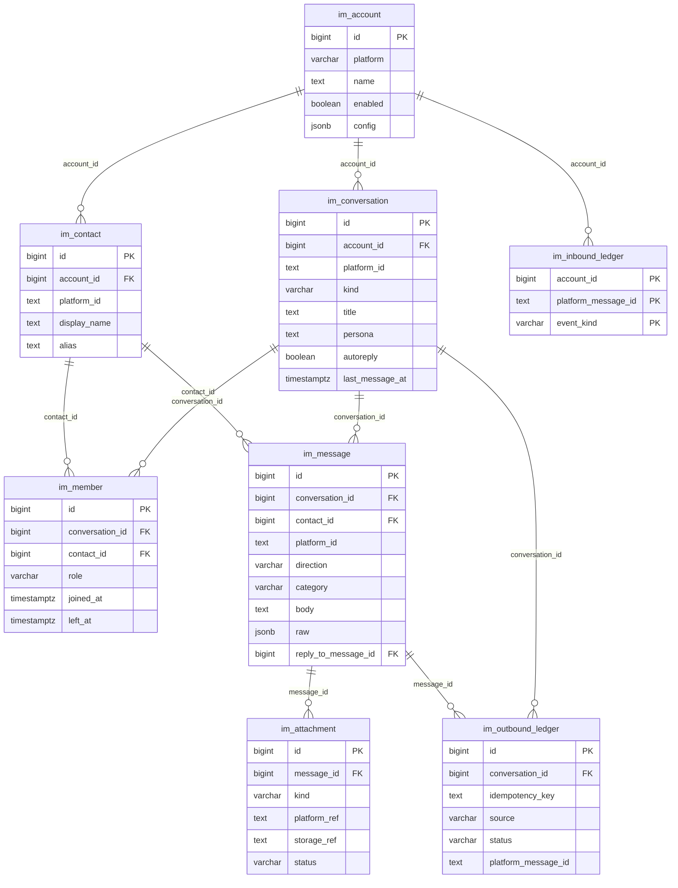
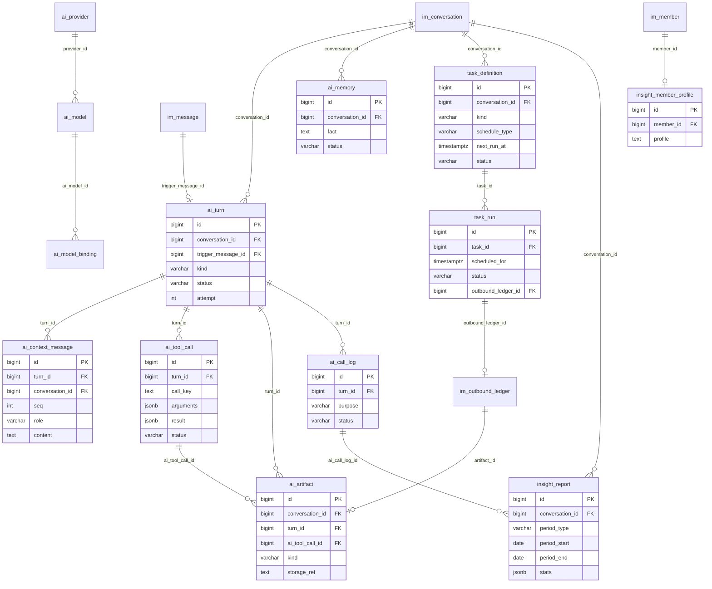

> **⚠️ 本文档已被 v0.2 定稿取代（2026-11-16）**：终态 17 表以 V1__hub_foundation.sql 与 docs/er-model-v02-final.html 为准。相对本文的关键变更：ai_settings 单行表改为 ai_setting KV（四级作用域）；im_connection 改名 im_account；im_member 改名 im_conversation_contact_bind；task_*/insight_* 收编 im_ 前缀（im_task/im_task_log/im_report/im_conversation_contact_profile）；ai_turn/ai_context_message/ai_tool_call/ai_call_log/ai_model_binding/ai_artifact/im_report 七表删除（上下文不落库、无调用审计、槽位推导、报告实时生成不落库）。

# imaia 数据结构重设计（提案稿）

> 状态：待评审。配套 DDL：[schema-redesign.sql](schema-redesign.sql)（可直接在空库执行；已在 PostgreSQL 16 实测建表 + 种子 + 8 条关键不变式）。ER 图：[er-model-redesign.html](er-model-redesign.html)。
> 对照现状：[V1](../imaia-service/src/main/resources/db/migration/V1__hub_foundation.sql)–[V4](../imaia-service/src/main/resources/db/migration/V4__ai_intelligence.sql)、[ER 模型 v0.2](er-model.html)。
> 本文只重设计**持久化数据结构**（表 / 键 / 约束 / 关系），不改产品口径；落地影响见 §8。

---

## 1. 摘要

当前 v0.2 schema 是「一个会话 + 一张消息表 + 一组 AI 附属表」的扁平结构，能跑通主链路，但有四个结构性缺口：

1. **身份是文本**：消息发送者、群成员、画像都用 `sender_id`/`member_external_id` 字符串，同一个人跨会话、改名、退群重进都无法稳定识别。
2. **归档只有文本壳**：图片/语音/视频/文件没有结构化落点，附件只在需要时临时下载；「全量归档」实际只归档了正文和 raw。
3. **AI 与投递没有执行档案**：`ai_context_message` 只有 role/content，没有回合、序号、工具参数；发送没有本地账本，是否发过、发了什么、平台回执是什么，全靠平台侧幂等键。
4. **任务与报告没有历史**：任务状态就地覆盖，失败/重试/重复触发没有记录；报告缺 `period_end` 和时区，统计口径不可复现。

重设计后 **15 → 22 张表**，新增的不是功能表，而是四类「缺失的事实」：联系人、附件、执行实例、绑定关系。核心原则：**档案不可变、运行可重放、一个事实一个来源、幂等键前置**。

| 维度 | 现状 | 重设计 |
| --- | --- | --- |
| 会话身份 | `im_conversation` 单层 | 保留；补 `last_message_at`、`archived_at`、`title` |
| 发送者 | 消息内 `sender_id/name` 文本 | `im_contact` 目录 + 消息 `contact_id` |
| 群成员 | `group_member` 快照 | `im_member` 加入区间（`joined_at/left_at`） |
| 附件 | 无 | `im_attachment`（平台键 + 存储键 + 状态） |
| 出站 | 平台幂等键 | `im_outbound_ledger` 本地账本（键唯一 + 回执 + 归档回指） |
| AI 上下文 | `ai_context_message` 平铺 | `ai_turn` 回合 + `ai_context_message.seq` + `ai_tool_call` |
| 任务 | 定义即执行 | `task_definition` 定义 + `task_run` 执行实例 |
| 模型选择 | 目录推导 + 多候选报错 | `ai_model_binding` 显式槽位 |
| 报告 | `stats JSONB` + `ai_report` | 补 `period_end`、`timezone`、`status`、调用审计回指 |

---

## 2. 现状诊断（按严重度）

### 2.1 身份与成员：同一个人被拆成多份

- [ImMessage.java](../imaia-service/src/main/java/com/imaia/domain/ImMessage.java)（旧版）把 `senderId`、`senderName` 直接存在消息行；`group_member` 只存 `member_external_id` + `display_name`；`member_analysis` 又以 `(conversation_id, member_external_id)` 为键。
- 后果：同一个人换了昵称，[MemberAnalyzer.java](../imaia-service/src/main/java/com/imaia/ai/MemberAnalyzer.java#L56-L60) 只能靠 `senderName contains` 兜底；同一个人在不同群/私聊的画像无法关联；成员退群重进没有时间维度，统计「某时段在群成员」不可做。
- 根因：**联系人（跨会话稳定身份）** 与 **成员关系（会话内加入区间）** 被压成了一张表。

### 2.2 归档不完整：媒体与消息关系没有结构化落点

- 旧 `im_message.kind`（当时叫 `category`）只说明「这是图片」，平台键（daemon media key / 飞书 `image_key`）埋在 `raw` JSONB 里；[ImAdapter.java](../imaia-service/src/main/java/com/imaia/adapter/ImAdapter.java#L51-L57) 的 `downloadAsset` 是**按需**调用，没下载就没有记录。
- 没有 `reply_to` / `thread` 列；[InsightService.java](../imaia-service/src/main/java/com/imaia/ai/InsightService.java) 只能用「最近 N 条」拼上下文。PRD REQ-060 要的「回复时延、@ 提及与被 @ 回复率」在现有表上算不出来。
- 后果：「全量归档」不可验证；媒体资产无法盘点；群聊话题/回复链分析没有地基。

### 2.3 AI 回合不可还原

- [AiChatService.java](../imaia-service/src/main/java/com/imaia/ai/AiChatService.java#L106-L114) 一次回复写入多条旧 `ai_message`（user/tool/assistant，现 `ai_context_message`），但没有 `turn_id`、没有 `seq`、没有工具参数；`tool_name` 是唯一线索，`content` 是工具结果的纯文本。
- 旧 `ai_message.source_message_id` 只标在 user 行；助手回复、工具产物、发送记录三者之间没有键可以串起来。
- 后果：无法回答「这条回复用了哪个模型、调了哪些工具、生成了什么、发出去没有」；审计只能看 `ai_call_log` 的松耦合记录。

### 2.4 出站投递没有本地账本

- `sendText/sendMedia` 的幂等完全委托平台（daemon `Idempotency-Key` / 飞书 `uuid`），本地只在 `DuplicateSendException` 里被动处理。
- 没有记录：这次发送是谁触发的（回复/任务/手动）、平台返回的 message id、重试次数、失败原因。
- 微信侧 `origin` 归因只能靠 60 秒时间窗近似（[handover §8](handover-imaia.md)），因为发送与归档回流之间没有键。

### 2.5 任务没有执行实例

- [TaskDefinition.java](../imaia-service/src/main/java/com/imaia/domain/TaskDefinition.java) 同时承载定义与运行态：`status`、`last_fired_at`、`last_error`、`next_fire_at` 就地覆盖；`fire_at`/`cron` 二选一靠空值表达。
- [TaskRunner.java](../imaia-service/src/main/java/com/imaia/ai/TaskRunner.java) 每 30 秒扫表，失败时「周期任务留 pending、一次性置 failed」，但没有「第几次执行、计划时刻、输出、关联投递」的记录。
- 没有 `(task_id, scheduled_for)` 唯一约束：多实例/轮询重叠时可能重复触发；报告任务的 `periodType` 藏在 `params` JSON 里。

### 2.6 模型槽位靠推导 + fail-fast

- [AiModelCatalog.java](../imaia-service/src/main/java/com/imaia/config/AiModelCatalog.java#L63-L146) 从 `modalities + tool_call` 推导 chat/image/video 槽位；同一槽位出现两个候选直接抛异常（「Trim the directory」）。
- 这是把**部署选择**（我想用哪个模型）编码成了**数据推断**；控制台无法显式表达「chat 用 A、生图用 B」，目录一多就运行期报错。

### 2.7 报告口径不可复现

- [InsightReport.java](../imaia-service/src/main/java/com/imaia/domain/InsightReport.java) 只有 `period_start`（DATE）没有 `period_end`；时区取 `ZoneId.systemDefault()`（[InsightService.java](../imaia-service/src/main/java/com/imaia/ai/InsightService.java#L89-L93)），换机器/夏令时会改变周窗口。
- `stats JSONB` 无 schema、无版本；`ai_report` 与那次模型调用没有关联；重新生成会覆盖旧值，无法对比。

### 2.8 幂等两套键不对齐

- 归档去重：`UNIQUE(conversation_id, message_id)`；投递门控：`UNIQUE(account_id, message_id)`。两个账本、两种作用域，没有事件类型；`processed_message` 只增不删。
- 消息事件没有类型，未来接「编辑/撤回」要么加列，要么另起表。

### 2.9 运行态只在 Redis / 内存

- 微信游标存 Redis（不可达降级内存），Redis 清空/进程崩溃后只能从实时尾部重连；连接健康状态（running/degraded/last_error）没有持久化落点，控制台看不到「这条连接现在到底怎样」。
- 本设计把**游标**视为可重建的运行态，暂不落库（见 §9 开放问题）；但**连接健康**建议落库，否则概览页永远只有「启用/停用」。

### 2.10 约定缺失

- 字符串列随意 `VARCHAR(256)`，没有长度/格式约束；没有 `CHECK` 约束，枚举值只靠 Java `@Convert`；FK 删除行为未显式声明；多数表没有 `updated_at`。

---

## 3. 设计原则

| # | 原则 | 落法 |
| --- | --- | --- |
| P1 | **档案不可变，运行可重放** | `im_message/im_attachment` 只追加；`ai_turn/ai_context_message/task_run/im_outbound_ledger` 记录每次执行，可重放可审计 |
| P2 | **一个事实一个来源** | 人的身份在 `im_contact`；槽位选择在 `ai_model_binding`；报告区间在 `insight_report`；消息发送者在 `im_message.contact_id` |
| P3 | **身份与关系分离** | `im_contact`（谁）× `im_member`（在哪个会话、什么角色、哪段时间） |
| P4 | **命令与执行分离** | `task_definition`（定义）≠ `task_run`（一次触发）；`ai_turn`（一次回合）≠ `ai_call_log`（一次模型调用） |
| P5 | **幂等键前置** | 入站：`im_inbound_ledger` 复合主键；出站：`im_outbound_ledger.idempotency_key`；回合：`ai_turn.trigger_message_id` 部分唯一；任务：`(task_id, scheduled_for)`；报告：`(conversation, period_type, period_start)` |
| P6 | **审计可回指** | 产物 → 工具调用 → 回合；投递 → 回合/任务执行；报告 → 模型调用；历史保留名称快照，目录删除后仍可读 |
| P7 | **数据库兜底不变式** | 枚举 `CHECK`、范围 `CHECK`、部分唯一索引、显式 FK 动作；应用层校验之外再兜一层 |
| P8 | **只做产品要的** | 不引入多租户、权限、跨平台人物合并、消息事件溯源；这些留扩展位（§9） |

---

## 4. 新模型总览

### 4.1 IM 域

### 4.2 AI 域

---

## 5. 表清单（22）

### 5.1 接入与 IM 域（8）

| 表 | 职责 | 关键约束 |
| --- | --- | --- |
| `im_account` | 平台账号（平台、名称、启停、config JSONB） | `UNIQUE(platform, name)` |
| `im_conversation` | 统一会话身份；平台原生 ID 只在 `platform_id` | `UNIQUE(account_id, platform_id)`；`kind ∈ direct/group/channel` |
| `im_contact` | 账号内稳定联系人（平台用户 ID、昵称、备注、头像） | `UNIQUE(account_id, platform_id)` |
| `im_member` | 成员关系（角色、加入/离开区间、群昵称） | `UNIQUE(conversation_id, contact_id, joined_at)` + 部分唯一「活跃区间」 |
| `im_message` | 不可变消息档案（发送者、方向、kind、正文、raw_payload、回复/线程） | `UNIQUE(conversation_id, platform_id)` |
| `im_attachment` | 消息附件/媒体（平台键、存储键、MIME、尺寸、哈希、下载状态） | `UNIQUE(message_id, kind, platform_ref)` |
| `im_inbound_ledger` | 入站投递幂等账本（连接 × 平台消息 × 事件类型） | 复合主键 |
| `im_outbound_ledger` | 出站投递账本（幂等键、来源、回执、归档回指、重试） | `UNIQUE(idempotency_key)` |

### 5.2 AI 域（10）

| 表 | 职责 | 关键约束 |
| --- | --- | --- |
| `ai_setting` | 能力配置 KV（四级作用域：platform/account_id/conversation_id 全 NULL=全局；默认提示词、窗口、@ 门控、静默时段、时区、总开关 + 会话级 persona/autoreply） | 表达式唯一索引兜 NULL 组合；`HH:mm` 字符串（避开 JDBC 时区偏移）；缺键取代码内置默认 |
| `ai_provider` | 接入商（openai / tavily / other；由用户手动添加，不预置） | `UNIQUE(name)`；`kind` |
| `ai_model` | 模型目录（仅由接入商 `/v1/models` 同步 + models.dev 富化；无预置；enabled/params 本地标注） | `UNIQUE(provider_id, model_key)`；`jsonb_typeof` 校验 |
| `ai_model_binding` | 槽位 → 模型（chat/vision/image/video） | `slot` 主键 |
| `ai_turn` | 一次 AI 回合（触发消息、状态、尝试次数、token） | 部分唯一 `trigger_message_id` |
| `ai_context_message` | 回合内上下文行（seq、role、content、tool_call_key） | `UNIQUE(turn_id, seq)` |
| `ai_tool_call` | 工具调用（名称、参数、结果、状态、耗时） | `UNIQUE(turn_id, call_key)` |
| `ai_memory` | 长期记忆（类型、状态、来源、被取代） | 部分索引 `WHERE status='active'` |
| `ai_artifact` | 生成媒体档案（kind、MIME、大小、哈希、存储、投递状态） | `kind/storage/status` CHECK |
| `ai_call_log` | 模型调用审计（用途、模型、token、耗时、错误） | 名称快照 + 可空 FK |

### 5.3 任务与洞察（4）

| 表 | 职责 | 关键约束 |
| --- | --- | --- |
| `task_definition` | 任务定义（kind、schedule_type、run_at/cron、时区、状态） | 一次性/周期字段互斥 CHECK |
| `task_run` | 一次计划触发（计划时刻、状态、输出、投递） | `UNIQUE(task_id, scheduled_for)` |
| `insight_report` | 洞察报告（周期、时区、stats、评析、调用回指） | `UNIQUE(conversation_id, period_type, period_start)`；`period_end > period_start` |
| `insight_member_profile` | 成员画像（挂 im_member，一人一会话一份） | `UNIQUE(member_id)` |

### 5.4 被移除 / 重命名的对象

| 旧 | 新 | 处理 |
| --- | --- | --- |
| `assistant_settings` | `ai_setting` | 先改名 `ai_settings`，V7 再改 KV：`quiet_hours_*` 存 `HH:mm` 字符串、新增 `timezone`、拆行存储 |
| `group_member` | `im_contact` + `im_member` | 拆为「人」与「关系」 |
| `processed_message` | `im_inbound_ledger` | 增加 `event_kind`，复合主键，随连接级联清理 |
| `im_message.message_id` | `im_message.platform_id` | 与 `platform_id` 词表统一 |
| `im_conversation.title` | `im_conversation.title` | 会话展示名统一叫 title |
| `task_definition.params` | `task_definition.payload` | 语义更准确，不加结构 |

---

## 6. 关键不变式（落地时逐条对应）

| 不变式 | 数据库实现 | 业务含义 |
| --- | --- | --- |
| 同会话同平台消息只归档一次 | `UNIQUE(conversation_id, platform_id)` | 事件重放不产生重复档案 |
| 同连接同消息同事件只处理一次 | PK `(account_id, platform_message_id, event_kind)` | 会话登记前也能门控；支持后续 edited/recalled |
| 同幂等键只发送一次 | `UNIQUE(idempotency_key)` | 重试复用 delivery 行，不重复发 |
| 同触发消息只开一个 AI 回合 | 部分唯一 `ai_turn(trigger_message_id)` | 上下文不重复膨胀；重试只增 `attempt` |
| 同任务同计划时刻只执行一次 | `UNIQUE(task_id, scheduled_for)` | 多实例/轮询重叠也不重复发 |
| 同会话同周期报告一份 | `UNIQUE(conversation_id, period_type, period_start)` | 重算覆盖，不产生重复报表 |
| 同会话同一人只有一个活跃成员区间 | 部分唯一 `im_member` `WHERE left_at IS NULL` | 退群重进有历史，但不会出现两个「当前成员」 |
| 一个槽位只有一个模型 | `ai_model_binding.slot` 主键 | 运行期不再「多候选报错」 |
| 静默时段可跨天判断 | `quiet_hours_start <> quiet_hours_end` + 应用层 | 00:00–07:00 与 22:00–06:00 都成立 |
| 删除有数据的连接被拒绝 | FK 默认 `RESTRICT` | 控制台「已有会话的连接禁止删除」由数据库兜底 |

---

## 7. 旧 → 新映射与数据迁移

### 7.1 列级映射（主要）

| 旧（v0.2） | 新（本次重设计） | 说明 |
| --- | --- | --- |
| `im_message.message_id` | `im_message.platform_id` | 平台消息 ID |
| `im_message.sender_id` | `im_message.contact_id` | 先 upsert `im_contact` 再回填；展示名取 `contact.display_name/alias` |
| `im_message.sender_name` | `im_message` 不存姓名字段 | 改用 `contact.display_name`；历史快照可放 `raw_payload`（或加 `sender_name_snapshot`，实施时定） |
| `im_message.created_at` | `im_message.occurred_at` | 平台发生时间与落库时间分开 |
| `im_message.category` | `im_message.kind` | 与 artifact/task/memory/contact 的 `kind` 统一 |
| `im_message.raw` | `im_message.raw_payload` | 语义更明确 |
| `im_conversation.display_name` | `im_conversation.title` | 控制台展示名 |
| `group_member.*` | `im_contact` + `im_member` | 先按连接 + 平台用户 ID 升联系人，再按会话升成员区间 |
| `member_analysis.member_external_id` | `insight_member_profile.member_id` | 必须先建成员关系 |
| `member_analysis.model_id` | `insight_member_profile.ai_call_log_id` | 画像生成那次调用 |
| `assistant_settings.quiet_hours_start/end` | `ai_setting`（key=`quiet_hours_*`） | 仍存 `HH:mm` 字符串；避免 JDBC 时区换算偏移 |
| `assistant_settings.*` | `ai_setting` | 新增 `timezone`；V7 起拆 KV 行 |
| `scheduled_task.fire_at/cron` | `task_definition.run_at/cron_expr` | 空值二选一 → 显式 `schedule_type` |
| `scheduled_task.params` | `task_definition.payload` | 报告周期等 |
| `scheduled_task.last_fired_at/last_error` | `task_run` | 每次执行一行 |
| `ai_message.source_message_id` | `ai_turn.trigger_message_id` | 回合级来源 |
| `ai_message.tool_name`（tool 行） | `ai_tool_call` | 工具参数/结果独立表 |
| `ai_artifact.ai_message_id/model_id` | `turn_id/ai_tool_call_id/ai_model_id` | 可回指 |
| `ai_call_log.ai_message_id` | `ai_call_log.turn_id` | 调用属于回合 |
| `conversation_report.model_id` | `insight_report.ai_call_log_id` | 评析调用审计 |
| `processed_message.*` | `im_inbound_ledger.*` | 增加 `event_kind`，复合主键 |
| `（新表）` | `im_outbound_ledger` | 出站发送账本，替代平台幂等键单点 |

### 7.2 迁移策略

**推荐：重写迁移，不保留存量数据。** 依据：仓库仍是 dev 阶段，[handover §7 第 7 步](handover-imaia.md) 已计划一次性重置 dev 库；保留数据反而要写大量回填 SQL 和临时表。

步骤：

1. 停服务，`pg_dump` 一份现库（只作回滚，不作迁移输入）。
2. 用 [schema-redesign.sql](schema-redesign.sql) 替换 `V1–V4`（或合并为新的 `V1`），清空 `flyway_schema_history` 后启动重建。
3. 旧数据如需留档，另存 `legacy_*` 表或离线导出，不混入新模型。

**若必须保留数据**：新增 `V5__schema_v2.sql`，按「先建新表 → 双写 → 回填 → 切读 → 删旧列」四步走；回填顺序必须是 `im_account → im_contact → im_conversation → im_member → im_message → im_attachment → ai_* → task_run → report`。由于 `group_member` 拆表和 `ai_context_message` 回合化没有唯一自然键，回填脚本要按时间窗聚合，成本高——这也是推荐「重置」的原因。

---

## 8. 落地影响清单

### 8.1 后端

| 层 | 改动 |
| --- | --- |
| 迁移 | V1–V4 重写（推荐）或新增 V5；Flyway checksum 需 `repair`/清库 |
| 实体 | 15 → 22：新增 `ImContact/ImMember/ImAttachment/ImOutboundLedger/AiTurn/AiToolCall/TaskRun/AiModelBinding`；重命名 `AiSettings→AiSettings/ProcessedMessage→ImInboundLedger`；`ImMessage` 改 `externalId/contactId/replyTo`；`ImConversation` 改 `title/lastMessageAt` |
| 仓储 | 新增联系人 upsert、活跃成员查询、附件待下载队列、投递按幂等键查询、回合按触发消息查询、任务执行历史、槽位绑定查询；`ImMessageRepository` 的 sender 查询改 join contact |
| 归档链路 | [MessageArchiveHandler.java](../imaia-service/src/main/java/com/imaia/handler/MessageArchiveHandler.java)：upsert contact → upsert member → 写消息 → 写附件（平台键）→ 更新会话 `last_message_at` |
| 回复链路 | [AiReplyHandler.java](../imaia-service/src/main/java/com/imaia/ai/AiReplyHandler.java)：开/复用 `ai_turn`、写 `ai_context_message.seq`、工具落 `ai_tool_call`、发送前建 `im_outbound_ledger`、回执回填 |
| 任务 | [TaskRunner.java](../imaia-service/src/main/java/com/imaia/ai/TaskRunner.java)：先插 `task_run`（命中唯一即跳过）、执行后回填；`next_run_at` 按任务时区计算 |
| 洞察 | [InsightService.java](../imaia-service/src/main/java/com/imaia/ai/InsightService.java)：窗口用 `ai_setting.timezone`，写 `period_end`，评析调用写 `ai_call_log_id` |
| 画像 | [MemberAnalyzer.java](../imaia-service/src/main/java/com/imaia/ai/MemberAnalyzer.java)：按 `member_id` 取消息与画像 |
| 目录 | [AiModelCatalog.java](../imaia-service/src/main/java/com/imaia/config/AiModelCatalog.java)：改为读 `ai_model_binding`；带图轮优先 `vision` 槽位、未绑定回退 `chat`；未绑定 = 能力关闭，不再推导/报错 |
| 目录同步 | [ModelSyncService.java](../imaia-service/src/main/java/com/imaia/ai/ModelSyncService.java)：只同步 `ai_provider.kind='openai'`，跳过 tavily |
| 搜索 | [WebSearchClient.java](../imaia-service/src/main/java/com/imaia/ai/WebSearchClient.java)：按 `kind='tavily'` 找接入商，不再按名字硬编码 |
| API | DTO 字段对齐（`title`、`externalId`、`memberId`、`periodEnd`）；新增 `GET /api/tasks/{id}/runs`、`GET /api/turns/{id}`、`GET /api/deliveries`（可选） |

### 8.2 前端

| 位置 | 改动 |
| --- | --- |
| [api.ts](../imaia-web/src/features/imaia/api.ts) | `Conversation.title`、`MessageRow.externalId`、`MemberRow.memberId`、`TaskRow.scheduleType`、`ReportRow.periodEnd`、`Artifact.mimeType/size` |
| 收件箱 | 成员列表改用 `memberId`；画像请求带 `memberId`；消息展示回复引用（若有） |
| 任务页 | 新建时选 `scheduleType`（once/cron）；行点开看执行历史（`task runs`） |
| 报表页 | 显示 `period_end`、生成状态、评析调用 |
| 接入页 | 增加运行时状态列（后续加连接健康表时） |
| 模型页 | 槽位绑定选择器（chat/vision/image/video） |

### 8.3 测试

- 现有 58 个测试按新实体/构造器改；重点补：`contact upsert 幂等`、`member 活跃区间唯一`、`delivery 幂等键冲突`、`turn 重放只增 attempt`、`task run 重复触发被唯一键挡住`、`report 跨时区窗口`。
- 真机联调前先跑 `mvn test` + `npm run build`。

---

## 9. 取舍、未做与开放问题

### 明确不做（本期）

- **跨平台人物合并**：微信和飞书的同一个人仍不合并。按 PRD「跨线桥接不做，数据模型也不预留」，需要时再加 `im_person` + `im_person_contact`，非破坏性。
- **消息编辑/撤回事件溯源**：`im_inbound_ledger.event_kind` 已留位；真要接时加 `im_message_event` 追加表，不改主档案。
- **多租户 / RBAC / 审计日志**：仍单用户、仅回环。
- **统计指标表化**：`stats JSONB` 保留，避免为十几个指标建宽表；需要跨报告查询时再加 `report_metric` 投影表。

### 开放问题

| # | 问题 | 建议默认 |
| --- | --- | --- |
| Q1 | 附件下载策略：归档时立即下载 vs 懒下载 | 懒下载：先登记 `pending`，后台队列补；daemon 媒体有过期风险时再改即时 |
| Q2 | 游标是否落库 | 暂不落；Redis 不可达降级内存 + 事件幂等已能兜底。若要求重启不重放，再加 `im_stream_state` |
| Q3 | `im_message` 是否保留 `sender_name` 快照 | 建议保留一列只读快照（改名后历史消息仍显示当时昵称）；本 DDL 暂未加，评审后定 |
| Q4 | 任务时区：全局 vs 每任务 | 每任务 `timezone`（本 DDL 已加），默认取 `ai_setting.timezone` |
| Q5 | 未绑定模型槽位的行为 | 能力关闭（不生图/不视频）；带图轮未绑定 `vision` 时回退 `chat`，chat 也不支持视觉则只归档图片、文本回复；不回退到目录推导 |
| Q6 | 保留策略 | `im_inbound_ledger` 90 天、`ai_call_log` 180 天、`im_attachment` 跟随消息；上线前定 |
| Q7 | 凭据加密 | v1 仍入库 + 掩码；暂不引 KMS |
| Q8 | 是否引入 `im_account_runtime` | 本期不加；控制台先看进程内状态，需要跨重启展示账号健康时再加（status/last_event_at/last_error） |

---

## 10. 一页结论

- **别急着加功能表**：先把「人是谁、消息带了什么、这次 AI 做了什么、这条消息发没发出去、这个任务第几次跑」这五件事落成结构化数据。
- **档案与运行分离**：`im_*` 只追加；`ai_turn/ai_call_log/task_run/im_outbound_ledger` 记录每次执行。
- **幂等键五处前置**：入站账本、出站键、回合触发、任务计划时刻、报告周期。
- **模型选择显式化**：绑定表替代目录推导，控制台能表达意图。
- **推荐重置 dev 库重写 V1–V4**，不写高成本回填脚本；真要保数据再走 V5 双写。

评审通过后，实施顺序建议：迁移 + 实体/仓储（1）→ 归档与目录（2）→ 回复/投递/任务（3）→ 洞察/画像（4）→ API/前端契约（5）→ 测试与真机（6）。
