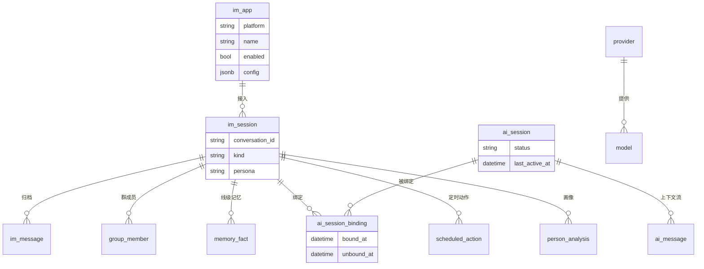

# imaia 产品需求文档（PRD）：智能聚合中枢 IM

| 项 | 值 |
| --- | --- |
| 文档版本 | v0.1（评审稿） |
| 状态 | 待评审 |
| 产品代号 | imaia |
| 关联文档 | HLD / LLD 待编写；仓库内 `imaia-service/README.md` 为现有实现说明 |

## 1. 背景

个人用户的真实对话分散在多个 IM 平台：微信承载私人与生活社交，飞书承载工作协作。各平台
的会话数据彼此孤立，格式与接入方式互不兼容；AI 助理能力（自动回复、记忆、定时任务、
人物画像）如果逐平台分别搭建，会重复建设且无法共享上下文。

imaia 的定位是**智能聚合中枢 IM**：一个管理系统，把多个 IM 平台统一接入到一套自有的
会话模型之上，并原生支持接入 AI 能力。对各平台而言，imaia 是一个连接方；对使用者而言，
imaia 是查看、检索、指挥所有对话与 AI 行为的唯一入口。

## 2. 问题陈述

1. **接入碎片化**：每个 IM 的接入方式（个人号网关、平台应用、bot token）、消息格式、
   媒体协议完全不同，逐平台开发成本高，且没有统一的数据模型承接。
2. **AI 行为无栖身之处**：记忆、人设、定时任务、画像等 AI 能力需要稳定的会话与归档
   数据作为地基；没有统一模型，这些能力无法跨平台工作。
3. **行为不可控**：个人号上的自动回复直接暴露在平台风控之下，缺少白名单、频控、静默
   时段等护栏的 AI 行为是高风险行为。
4. **不可管理**：接入配置、模型目录、策略、记忆散落在配置文件与代码中，无法统一查看
   与调整。

## 3. 目标

- G1 统一接入：微信、飞书两平台接入后，全部会话消息以一套统一模型归档与呈现；新增
  平台仅需新增一个适配器实现。
- G2 AI 原生：接入的会话自动获得 AI 能力（自动回复、记忆、画像、定时动作），AI 的
  上下文与归档数据严格分离。
- G3 可管理：接入配置、模型目录、AI 策略、记忆、定时动作全部可通过控制台 API 查看与
  调整，敏感信息不出系统。
- G4 行为安全：所有自动化行为默认关闭、显式开启，且有白名单与风控护栏约束。

## 4. 非目标

- 多用户/多租户：v1 为单用户（hub 主人）自用系统。
- 跨平台桥接的产品化：数据模型保留桥接能力（一条 AI 会话可绑定多条 IM 线），但桥接
  的产品行为与交互不在 v1 范围。
- 非 IM 渠道接入（邮件、短信等）：不在本期。
- 独立部署的公开服务：系统仅绑定本机回环地址，不做公网服务。

## 5. 用户与角色

| 角色 | 说明 |
| --- | --- |
| hub 主人 | 唯一的系统用户，兼任管理员与使用者：配置接入、编辑策略与人设、查看会话与档案、与 AI 交互 |
| IM 联系人与群成员 | 外部消息的来源方，不是系统用户；其消息按平台投递规则进入归档 |
| AI 助理 | 系统内的行为者：在已接入会话中回复、执行意图（记忆/提醒/画像/生图生视频） |

## 6. 范围

### 6.1 In Scope（v1）

- 微信（经 agent-wechat 社区 daemon）与飞书（官方开放平台自建应用，WS 长连接）两个
  平台的接入与归档。
- 接入配置结构化存储与多实例支持（同一平台可配置多个接入实例）。
- 统一会话模型：会话线（im_session）、不可变消息档案（im_message）、幂等投递。
- AI 双层会话模型：AI 上下文实例（ai_session）与 IM 线解耦，通过绑定关系关联；支持
  重开对话（换绑）与未来的跨线桥接。
- AI 行为：多模态自动回复（文本/图片/语音/视频封面/表情包）、意图标记（提醒/记忆/
  分析）、生成式媒体（生图/生视频）、TTS 语音回复、语音转写（ASR）。
- 记忆体系：线级记忆与全局记忆，支持编辑与晋升。
- 人物画像：基于归档消息生成联系人的性格/兴趣/互动风格分析。
- 定时动作：一次性提醒与 cron 式主动消息，含静默时段规避与随机抖动。
- 风控护栏：白名单、群 @ 门控、静默时段、三级频控（按会话每分钟/全局每小时/每日，
  按平台隔离）、超短消息不回、回复前随机延迟。
- 控制台 API：概览、会话目录、消息检索、记忆管理、定时动作、模型目录、AI 策略、
  风控策略（回环地址 only）。
- WebUI 管理页面：覆盖控制台全部能力，与控制台 API 同源部署。
- 飞书侧真实联调验收。

### 6.2 Out of Scope（v1 明确不做）

- 跨线桥接的产品交互（数据模型已支持，交互与入口为后续版本）。
- "重开对话"的用户触发入口（数据模型与绑定机制已支持，触发面为后续版本）。
- 飞书群全量消息归档（需要平台敏感权限 `im:message.group_msg`，v1 默认只归档 @ 机器人
  消息）。
- 飞书音频气泡消息（AI 语音回复在飞书侧以文件消息发送）。
- 微信官方开放形态的接入（预留 `im_app` 抽象，待官方能力开放后新增适配器）。
- 多用户与公网部署。

## 7. 需求

### 7.1 统一接入

- REQ-001 系统支持以「接入实例（im_app）」为单元配置 IM 接入：每个实例声明所属平台、
  实例名称、启用状态与结构化配置（含该平台凭据）。同一平台允许多个实例并存。
- REQ-002 接入配置为系统内数据（结构化存储），不依赖环境变量；修改配置后重启生效。
- REQ-003 每个已启用的接入实例由对应平台适配器独立驱动：连接建立、断线重连、进度
  记录、媒体传输、消息发送全部封装在适配器内；核心流程不感知平台差异。
- REQ-004 未配置或未启用的接入实例不影响其他平台运行：对应平台的事件流跳过启动，
  其余平台照常工作。
- REQ-005 消息投递为至少一次语义：事件处理成功后记录进度；任何一步失败按原进度重放。
  处理器必须幂等，重复投递不得产生重复归档或重复回复。
- REQ-006 同一事件的连续处理失败达到阈值（默认 5 次）时终止该平台事件流并按配置退
  出进程，避免无限重放；网关瞬态故障（如边缘质询）单独计数、不触发毒事件终止。

### 7.2 会话与归档

- REQ-010 系统为每个平台原生的聊天通道维护一条会话线记录（im_session），含平台原生
  会话标识、展示名、类型（私聊/群聊）、线级人设、静音标记与最近活跃时间；首条消息
  到达即自动登记。
- REQ-011 所有收到的消息全量归档（im_message），保留原始平台报文（raw），归档以
  （接入实例, 平台消息 id）去重，重放不产生重复行。
- REQ-012 归档按平台原生语义保留消息类别（文本/图片/语音/视频/表情包/文件等）与
  @提及标记。
- REQ-013 群会话维护成员快照（成员外部标识、展示名、最近活跃）。
- REQ-014 飞书群的归档范围受平台权限约束：默认权限下仅 @ 机器人的群消息会到达系统
  并归档；全量归档需要额外敏感权限，v1 不启用。

### 7.3 双层会话（AI 上下文与 IM 线解耦）

- REQ-020 AI 上下文以「AI 会话（ai_session）」为独立实例存在；每条 IM 线通过绑定
  关系关联其当前 AI 会话（一条线同一时刻至多一个当前绑定）。
- REQ-021 换绑（旧绑定关闭 + 新建 AI 会话并绑定）实现"重开对话"：模型上下文清零，
  归档、记忆、画像、定时动作全部保留。
- REQ-022 绑定关系保留历史（含解绑时间），支持审计任一 AI 回复当时所处的 AI 会话。
- REQ-023 数据模型支持一条 AI 会话同时绑定多条 IM 线（桥接前提）；v1 不提供交互入口。
- REQ-024 模型历史按 AI 会话隔离：AI 会话内保存用户轮、工具轮与助手轮，重启不丢失；
  历史窗口按策略滚动（默认 20 轮）。

### 7.4 AI 行为

- REQ-030 AI 自动回复默认关闭，控制粒度为**线级开关**：每条会话线（im_session）上有
  独立的自动回复开关（默认关），在会话列表中随手切换；全局总开关（assistant_profile
  .enabled）保留作双保险。开关关闭的会话消息只归档、永不回复。
- REQ-031 自动回复支持多模态输入：文本直接进模型；图片走视觉模型；语音经 ASR 转写后
  按文本处理；视频与表情包通过封面/预览图理解；链路与文件类消息不触发回复。
- REQ-032 模型回复中的意图标记被解析执行：`[REMINDER:]` 落为定时提醒、`[MEMORY:]` 落
  为线级记忆、`[ANALYZE:]` 触发基于归档的人物画像并回发摘要。
- REQ-033 模型可通过工具调用生成图片与视频，产物上传至来源平台并发送，同时登记产物
  档案（提示词、模型、来源、状态）。
- REQ-034 语音输入可开启语音回复（TTS）；合成失败自动降级为文本回复。
- REQ-035 群会话默认要求真 @ 触发；未 @ 的群消息仅作为上下文保留。私聊无需 @。
- REQ-036 所有发送动作携带由触发消息派生的幂等标识，事件重放不得造成重复发送。
- REQ-037 风控护栏（全部默认启用，阈值可调）：静默时段（默认 00:00–07:00 不回复）、
  单会话每分钟回复上限、全局每小时与每日上限（按平台独立计数）、超短消息不回复、
  回复前随机延迟；频控计数不可用时自动降级为进程内计数并告警。
- REQ-038 长期记忆分两级：线级记忆（仅该会话可见）与全局记忆（所有会话可见）；模型
  可通过 [MEMORY:] 产生线级记忆，控制台可编辑与晋升为全局。
- REQ-039 AI 产生的发送在归档中带来源标记 origin（human / ai）：微信平台上 AI 与主人
  共用同一账号，该标记由系统写入而非平台区分；统计与审计据此区分 AI 行为与主人人工
  行为。
- REQ-039a **人设四级回落**：人设（persona）只有一个概念，分四级作用域，按顺序回落、
  命中即用——会话级（im_session.persona）→ 应用级（im_app.persona）→ 平台级
  （platform_persona 表）→ 全局默认（assistant_profile.system_prompt）。意图标记等
  机制说明由系统固定注入，不受人设覆盖。

### 7.5 主动行为

- REQ-040 支持两类定时动作：一次性文本发送与 cron 式 AI 措辞发送；动作目标必须是
  会话目录中已登记的会话线，创建时校验。
- REQ-041 定时动作执行避开静默时段并附加随机抖动；幂等键由动作 id 派生，重试不重复
  发送；一次性动作失败标记为失败而非无限重试。

### 7.6 控制台与管理

- REQ-050 控制台 API 提供以下能力的查询与管理：总览统计、会话目录（跨接入实例聚合）、
  会话消息合并检索（归档 + AI 流）、记忆管理（编辑/删除/晋升）、定时动作管理、模型
  目录管理（接入商与模型）、AI 人设与风控策略、运行时信息（脱敏）。
- REQ-051 人设、模型目录、风控策略的修改即时生效，无需重启；接入配置修改重启生效。
- REQ-052 控制台仅绑定本机回环地址；接入凭据在任何响应中只以掩码形式出现，日志中
  不出现任何凭据明文。
- REQ-053 提供本地手动端点（默认关闭，显式开启）：手动与 AI 对话、向白名单会话主动
  发送、按名称生成人物画像。
- REQ-054 **WebUI 是完整的后台管理系统**（不是若干面板拼凑的页面）：作为系统级交付，
  覆盖全部资源的完整管理闭环——接入实例、会话与消息、记忆、定时动作、模型目录、
  人设与策略、会话洞察报表；每个资源提供一致的列表/筛选/详情/新建/编辑/删除/状态
  操作，系统级交互统一（分页、筛选、空态、加载与错误反馈、危险操作二次确认、表单
  校验），侧边导航与权限口径全系统一致。
- REQ-055 接入实例管理提供完整生命周期：新建、编辑（平台/名称/结构化配置）、启停、
  删除（已有会话数据的实例禁止删除并提示）；凭据在任何页面只以掩码显示，掩码值提交
  时还原为原值；配置编辑提示重启生效。
- REQ-056 WebUI 与控制台 API 同源部署（同一服务静态托管 /api），仅本机回环可访问；
  页面编辑的人设、策略、记忆、模型目录即时生效。

### 7.7 会话洞察（v1 交付）

基于归档数据的分析能力，三个出口全部交付：控制台报表页、群内指令（如
「@机器人 本周统计」→ 报告直接发回群里）、周期报告落库回看。

- REQ-060 **统计类**：成员输入字数与消息条数、活跃度排行、表情消息计数、每日开场者
  统计、回复时延（引用与时序双口径）、@提及与被@回复率，支持任意时间区间聚合。
- REQ-061 **AI 评析类**：成员幽默度评析、口头禅提取、话题分类与热度（按年/月/周
  生成报告落库，控制台回看）。
- REQ-062 **采集依赖类**：链接与附件细分归档；成员头像变更统计（依赖成员资料采集，
  微信侧能力待确认，见 OQ-8）。
- REQ-063 报告存储：周期报告与会话统计落库（conversation_report），按
  （会话线 × 周期类型 × 周期起点）唯一。

## 8. 用户 / 业务流程

### 8.1 接入流程

1. 主人在平台上完成前置准备（微信：daemon 创建 token；飞书：创建自建应用并开通机器人
   能力、事件订阅与权限）。
2. 主人将接入实例写入系统数据（平台、名称、结构化配置），启用。
3. 系统启动时加载已启用的接入实例，对应适配器建立连接并开始投递事件；首条消息到达后
   自动登记会话线并开始归档。
4. 配置错误（如凭据缺失）时系统快速失败并给出修复指引；实例未启用时该平台静默跳过。

### 8.2 被动回复流程

1. 平台消息到达 → 归档（去重）→ 会话目录刷新。
2. AI 开启且会话在白名单内 → 静默时段/幂等/方向/@门控依次校验 → 多模态组包 → 频控 →
   模型推理（含工具）→ 随机延迟 → 发送回复与生成媒体 → 意图落库 → 记录已处理。
3. 任一步失败：事件重放；重复投递被幂等门与归档去重吸收。

### 8.3 主动与管理流程

1. 主人在控制台调整人设/策略/记忆/模型目录 → 下一轮对话即生效（接入配置除外）。
2. 主人创建定时动作 → 执行器按 fire_at/cron 轮询 → 静默时段与抖动后发送 → 状态更新。
3. 主人查看总览与会话检索 → 跨接入实例聚合呈现。

## 9. 验收标准

| 编号 | 验收项 | 标准 |
| --- | --- | --- |
| AC-01 | 微信接入 | daemon 运行且配置启用后，微信私聊文本消息出现在归档，控制台可见 |
| AC-02 | 飞书接入 | 自建应用凭据配置并启用后，飞书私聊文本→AI 回复；群内 @ 机器人→回复，未 @→不回复 |
| AC-03 | 白名单 | 白名单外的会话消息只归档、永不触发回复 |
| AC-04 | 多模态 | 图片消息触发视觉回复；语音在配置 ASR 后转写回复；未配置 ASR 时语音静默 |
| AC-05 | 意图 | [REMINDER:] 到点发送；[MEMORY:] 记忆可在控制台查看并被后续对话引用；[ANALYZE:] 回发画像 |
| AC-06 | 幂等 | 同一消息事件重放（重启/断线）不产生重复归档、重复回复、重复发送 |
| AC-07 | 风控 | 超过分钟/小时/日上限后静默；静默时段零回复；上限按平台独立生效 |
| AC-08 | 双层会话 | 换绑后模型上下文为空，归档与线级记忆完整保留 |
| AC-09 | 隔离 | 一个接入实例未配置或停用时，其余平台收发不受影响 |
| AC-10 | 安全 | 全部 API 响应与日志中无凭据明文；服务仅监听 127.0.0.1 |
| AC-11 | 生成媒体 | [IMAGE:] 与工具生图的产物送达来源平台并登记档案 |
| AC-12 | 定时 | 一次性提醒到点发送且失败标记失败；cron 动作按计划重复且不与静默时段冲突 |
| AC-13 | WebUI 覆盖 | REQ-054 全部页面可用；人设/策略/记忆/模型目录编辑即时生效于下一轮对话 |
| AC-14 | 接入页掩码 | 接入实例页面凭据只显示掩码；提交掩码值不覆盖真实凭据；停用实例后对应平台流不再启动 |

## 10. 依赖与约束

### 依赖

| 依赖 | 用途 | 性质 |
| --- | --- | --- |
| agent-wechat 社区 daemon（wx serve） | 微信个人号的事件流/收发/媒体 | 外部组件，社区维护 |
| 飞书开放平台自建应用 | 飞书事件与收发（WS 长连接） | 外部平台，需开通机器人能力与权限 |
| magpie 网关（OpenAI 兼容） | 模型推理、生图、生视频、TTS、ASR | 外部服务 |
| PostgreSQL | 归档、历史、记忆、策略、接入配置 | 本地基础设施 |
| Redis | 频控计数、微信游标（不可达降级内存） | 本地基础设施 |

### 约束

- 系统仅绑定 127.0.0.1，不提供公网服务。
- 微信侧为个人号自动化，平台风控约束为硬约束：所有自动化行为必须有护栏且默认保守。
- AI 行为总开关默认关闭，任何自动回复必须同时满足：总开关开启 + 会话在白名单。
- 接入凭据仅存于系统内接入配置（含密钥），禁止环境变量明文注入与日志泄漏。

## 11. 风险

| 风险 | 影响 | 缓解 |
| --- | --- | --- |
| 微信个人号被平台风控 | 账号受限 | 护栏默认保守（白名单/频控/静默/延迟）；AI 默认关闭 |
| daemon 为社区组件，契约可能演进 | 微信线不可用 | 适配器隔离，契约变化只影响微信适配器；Calls API 等新能力暂不接入 |
| 飞书群消息权限为敏感权限 | 群归档不完整 | v1 接受仅 @ 消息归档并在文档明示；全量归档为后续决策 |
| ASR/生图等外部模型服务不可用 | 对应能力静默失败 | 失败按业务静默处理并记录日志，不阻塞消息流 |
| 多接入实例并存时的配置错误 | 消息串线 | 接入实例与会话线显式关联；核心按实例路由 |

## 12. 开放问题

| 编号 | 问题 | 状态 |
| --- | --- | --- |
| OQ-1 | 飞书群全量归档是否申请敏感权限 `im:message.group_msg` | 待主人决策，v1 默认不申请 |
| OQ-2 | "重开对话"的触发入口形态（控制台按钮 / IM 内指令 / both） | 机制已就绪，交互待定 |
| OQ-3 | 跨线桥接的首个产品场景（工作群桥接？私聊桥接？）与优先级 | 待定 |
| OQ-4 | 微信官方开放能力（app 形态）后的接入方式迁移 | `im_app` 抽象已预留，待官方开放 |
| OQ-5 | 开发库一次性重置（旧迁移已应用，新迁移集需清空 imaia 旧表后重建） | 待主人执行，SQL 另附 |
| OQ-6 | 飞书 AI 语音回复升级为原生音频气泡（需 opus 上传 + duration 元数据） | 后续版本评估 |
| OQ-7 | 会话洞察的触发面与立项范围（控制台报表 / 群内指令「@机器人 本周统计」/ 两者） | 候选方向已入思路池（7.7），立项另行决策 |
| OQ-8 | 微信侧成员头像与资料采集的可行性（daemon 是否提供成员资料接口） | 待确认 |

## 附：概念模型（非表结构）

概念说明：

- **im_app（接入实例）**：hub 与一个外部 IM 的连接单元。形态随平台而异（个人号网关
  会话、平台应用、bot），统一抽象为名称 + 结构化配置 + 启用状态；同一平台可多实例。
- **im_session（会话线）**：一条长期存在的聊天线（私聊/群），hub 的统一会话身份。
- **ai_session（AI 会话）**：一次有界的模型上下文实例；绑定表把线与 AI 会话关联，
  换绑即重开，多绑定即桥接。
- **im_message / ai_message**：人类真实流过的消息档案 vs 模型上下文流，二者永久分离。
- **memory_fact**：线级记忆挂线、全局记忆不挂线，重开 AI 会话不影响记忆。
